<picture>
  <source media="(prefers-color-scheme: dark)" srcset="assets/header-dark.svg">
  
</picture>

<br>

I run the cloud side of an early-stage SaaS company: the AWS account, the CI/CD behind eight repositories, and the servers everything lands on. When that is quiet, I write backend and data code in the product itself.

Click around. Each line below opens.

<details>
<summary><code>$ cat now.txt</code></summary>

<br>

- Moving a MySQL warehouse to Postgres without anyone noticing
- Making multi-tenant data isolation provable, not just likely
- Turning every "how did we do this last time?" into a runbook

</details>

<details>
<summary><code>$ cat beliefs.txt</code></summary>

<br>

1. A backup you have never restored is a hope, not a backup.
2. An alarm that has never fired is the same thing as no alarm.
3. An empty permission list means nothing is allowed. It never means everything.
4. A merge is not a deploy, and a deploy is not a run.
5. If a fix needs a sentence of explanation, the explanation goes in a runbook, not in someone's head.

</details>

<details>
<summary><code>$ ls ~/tools</code></summary>

<br>

```
cloud   EC2  RDS  S3  IAM  KMS  VPC  CloudWatch  SNS  SSM
ship    GitLab CI  self-hosted runners  nginx  systemd  pm2  Cloudflare
build   Python  FastAPI  SQL  TypeScript  Dart  Rust
```

</details>

<details>
<summary><code>$ history | tail -3</code></summary>

<br>

```
2026  cloud & infrastructure engineer
2025  ai / backend engineering intern
2022  b.tech, industrial iot
```

</details>

<details>
<summary><code>$ ./contact</code></summary>

<br>

[LinkedIn](https://www.linkedin.com/in/deekshant-tilwani/) · [deekshant661@gmail.com](mailto:deekshant661@gmail.com)

Fair warning: I am sarcastically funny.

</details>

<br>

<sub>The repositories are below. The interesting ones have a README.</sub>
