<picture>
  <source media="(prefers-color-scheme: dark)" srcset="assets/card-dark.svg">
  
</picture>

 

I keep the cloud side of a SaaS product running, and write backend and data code when it is quiet. Below are a few quests from the job. Open one.

 

<b>Quest &nbsp;·&nbsp; The Backup Nobody Had</b> &nbsp;difficulty ●●○

 

> Source control had gone two months without a backup, and nothing would have told anyone.
>
> **Cleared by** nightly encrypted backups to S3, a separate encrypted copy of the secrets, and an alarm that fires when a backup does *not* arrive. Then restoring it on a throwaway server, because an untested backup is just a hope.
>
> Reward &nbsp;`Restore Drill` unlocked

<b>Quest &nbsp;·&nbsp; Ten Quiet Days</b> &nbsp;difficulty ●●●

 

> A disconnect button looked fine and did nothing, for ten days, without one error.
>
> **Cleared by** finding three separate silent failures stacked on top of each other, each hiding the next.
>
> Reward &nbsp;+1 distrust of anything that "just works"

<b>Quest &nbsp;·&nbsp; Whose Data Is This</b> &nbsp;difficulty ●●●

 

> One customer with two connected organisations. The dashboard had to show exactly one organisation's rows: not both, and not none.
>
> **Cleared by** stamping every one of 631,464 raw rows with where it came from, then proving it on live data instead of assuming.
>
> Reward &nbsp;`Least Privilege` unlocked

 

**Equipped** &nbsp; AWS · GitLab CI · Linux · nginx · Python · FastAPI · SQL · TypeScript · Dart · Rust

**Party invite** &nbsp; [LinkedIn](https://www.linkedin.com/in/deekshant-tilwani/) · [deekshant661@gmail.com](mailto:deekshant661@gmail.com)

Side projects are in the repositories below.
